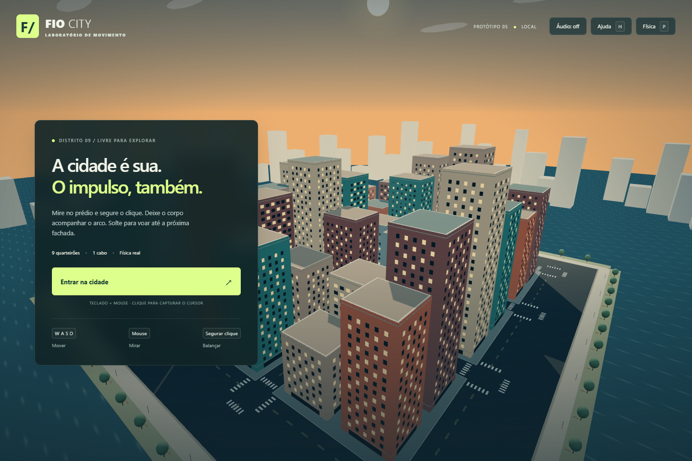

# FIO CITY

Protótipo 3D de deslocamento urbano por cabo, feito em Three.js. O foco é o balanço: uma âncora fixa em uma fachada real, cabo sem controle manual de comprimento, puxada inicial no chão, contorno de quinas e direção pela câmera ou WASD.



## Jogar localmente

Requer Node.js 18 ou superior.

```bash
npm test
npm start
```

Abra `http://127.0.0.1:4173` no navegador.

## Controles

- Clique ou `E`: prender/liberar o cabo.
- Mouse ou setas: orientar a câmera e conduzir o arco.
- `WASD`: mover e controlar o arco durante o balanço.
- `Espaço`: saltar.
- `Shift`: correr ou mergulhar.
- `P`: ajustes da física.

Consulte [LEIA-ME.md](LEIA-ME.md) para detalhes técnicos, limites e cenários de teste.
